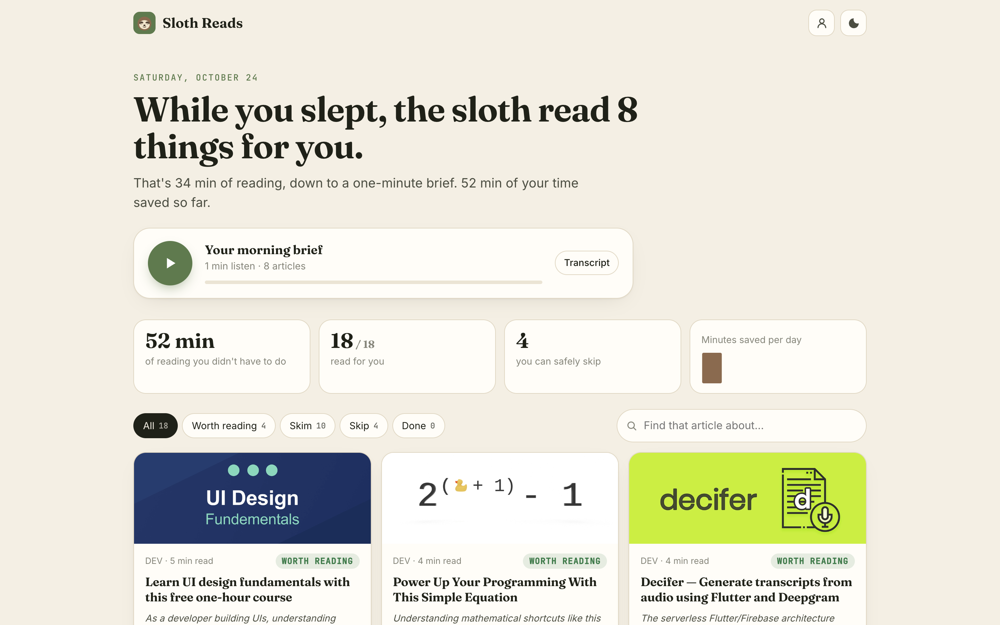
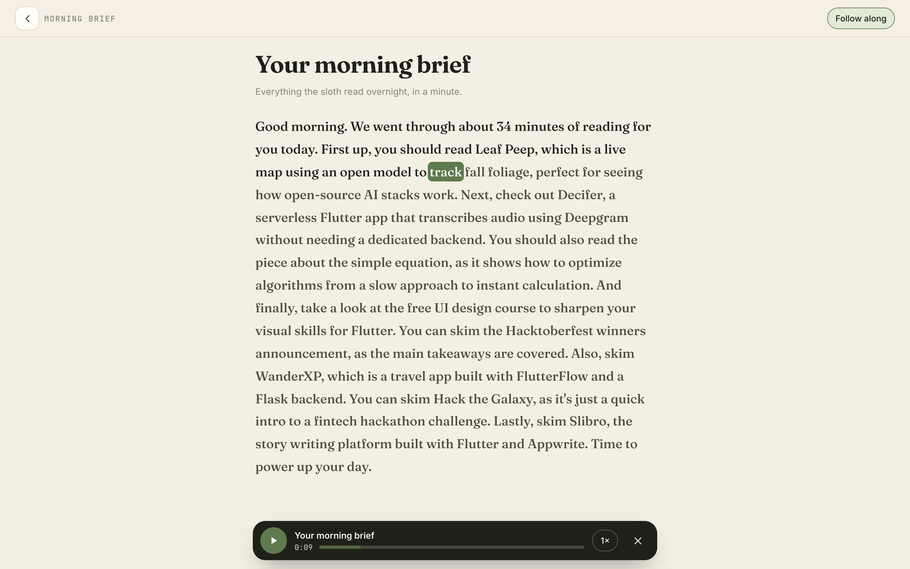
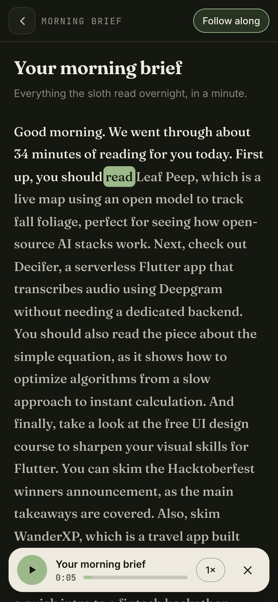
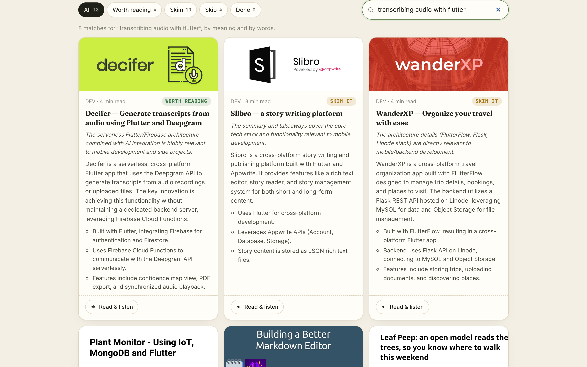

<p align="center"></p>

<h1 align="center">Sloth Reads</h1>

<p align="center">
  <b>Save it. Sleep on it.</b><br>
  Overnight, an open model reads everything you saved to read later, decides what's worth your time,<br>and briefs you in a minute the next morning. Then it reads the good ones to you, word by word.
</p>

<p align="center">
  <a href="https://slothreads.souvikbiswas.com"><b>Live: slothreads.souvikbiswas.com</b></a>
</p>

<p align="center"></p>

## What it does

1. **You save things to read later**: bookmark posts on DEV (synced every night), paste any link, or share it from your phone (it installs as an app with a share target).
2. **Overnight, the sloth reads them.** DigitalOcean Functions wake it every hour from 1 to 5 AM; each time it reads a few articles with **Gemma 4** and writes:
   - a 2 to 3 sentence summary and three takeaways,
   - a verdict, **worth reading, skim it, or skip it**, with one honest reason aimed at you,
   - an embedding for search.
3. **At 6 AM it writes your morning brief**: about a minute of listening for everything it read.
4. **Read & listen** opens any article in a clean reading view and reads it to you with ElevenLabs, **highlighting each word as it's spoken**. Tap any word to jump there.
5. **It counts the minutes you didn't spend**: a skipped article saves its whole reading time, a skimmed one all but a minute. The total and the per-day chart come straight from Tiger Data.

<table>
  <tr>
    <td width="62%"></td>
    <td width="38%"></td>
  </tr>
</table>

**Find it again by meaning:** "transcribing audio with flutter" finds the right post even without those exact words (pgvector + full text, merged with reciprocal rank fusion).



## How it's built

| | |
|---|---|
| **Model** | **Gemma 4** (31B on DigitalOcean serverless inference; `gemma4` on Ollama locally) reads, judges and writes the brief. **bge-m3** embeddings, the same model in both places. |
| **DigitalOcean** | **App Platform** runs the app from **Container Registry**; **Functions** with scheduled triggers are the overnight alarm clock; **serverless inference** runs Gemma and bge-m3. |
| **Tiger Data** | Items with **pgvector** embeddings and full-text search; `runs` and `saved` are **hypertables**; `saved_daily` is a **continuous aggregate** behind the minutes-saved chart. |
| **ElevenLabs** | `stream/with-timestamps` returns audio and character timings together. The app streams it in paragraph-sized chunks, so audio starts in about a second, **generation stops when you stop listening**, and every chunk (with its timings) is cached so replays are free and still highlight. |
| **Front end** | Plain HTML, CSS and JS. Installable, light and dark, phone to wide desktop. |

**Credits are protected.** The owner can voice anything; visitors share a small daily voice budget, checked before every chunk, and can always read.

## Run it

```sh
npm install
cp .env.example .env     # DATABASE_URL (Tiger Cloud), model settings, ELEVENLABS_API_KEY, DEV_API_KEY, OWNER_TOKEN
npm run dev              # http://localhost:8095
npm run nightly          # one overnight pass by hand
```

Locally it uses Ollama (`gemma4` and `bge-m3`), so the whole thing can run on your laptop. Set `TTS=say` for a free stand-in voice while developing.

**Deploy:** build and push the image to DigitalOcean Container Registry, create the app from `.do/app.yaml`, and deploy the schedule with `doctl serverless deploy functions`.

## Credits

Gemma 4 (Google, open weights) · bge-m3 (BAAI) · ElevenLabs voice "Eric" · Mozilla Readability · TimescaleDB and pgvector on Tiger Cloud · DigitalOcean.

MIT licensed.
